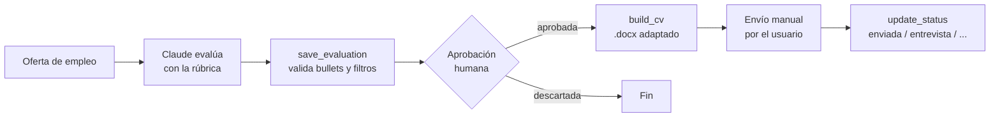

# postulador-mcp

[](https://github.com/diegoscore/postulador-mcp/actions/workflows/tests.yml)


Servidor MCP para **postular a empleos de forma asistida con IA, con un humano aprobando cada envío**: Claude evalúa las ofertas contra tu perfil y prepara el CV; tú decides y postulas.

## Qué hace y por qué es interesante técnicamente

- **Servidor MCP con 7 herramientas** (perfil, rúbrica, evaluación, cola, estados y CV) sobre el SDK `mcp` 2.x (`MCPServer`).
- **Guardrails anti-alucinación:** el agente solo puede elegir variantes y bullets que existen en el perfil, referenciados por id. Si inventa uno, `save_evaluation` y `build_cv` lo rechazan con un error explícito. También rechaza empresas excluidas y puntajes fuera de 0-100.
- **Cola de aprobación en SQLite:** cada evaluación pasa por estados (`nueva → aprobada → enviada → entrevista / rechazada / oferta`, o `descartada`). `build_cv` solo funciona con postulaciones aprobadas.
- **CV `.docx` adaptado por oferta:** una columna, amigable con ATS, en español o inglés. Solo reordena y selecciona contenido del perfil; nunca agrega texto nuevo.
- **Dos transportes:** `stdio` (Claude Desktop / Claude Code local) y `streamable-http` (con protección contra DNS rebinding y endpoint `/health`).
- **Docker y compose** con usuario sin privilegios, volúmenes para datos y salidas, y healthcheck.
- **Tests con pytest y CI** en GitHub Actions (Python 3.12).

## Flujo



Ejemplo de conversación:

1. *"Evalúa esta oferta con la rúbrica y guárdala"* (pegas la oferta).
2. *"Muéstrame la cola"* → revisas y dices *"apruebo la 3"*.
3. *"Genera el CV de la 3"* → queda en `salidas/`. Revísalo y expórtalo a PDF si el portal lo pide.
4. Postulas tú (o con un agente de navegador rellenando, y tú das el clic final).
5. *"Marca la 3 como enviada"*.

## Herramientas MCP

| Herramienta | Qué hace |
|---|---|
| `get_profile` | Devuelve el perfil (o una sección) |
| `get_scoring_rubric` | Devuelve la rúbrica de puntaje |
| `save_evaluation` | Guarda la evaluación en la cola; rechaza bullets/variantes inexistentes, empresas excluidas y puntajes fuera de rango |
| `list_queue` | Lista postulaciones por puntaje y estado |
| `get_application` | Detalle de una postulación |
| `update_status` | Cambia el estado; rechaza estados inválidos |
| `build_cv` | Genera el CV `.docx` (es/en); solo si la postulación está aprobada |

## Estructura

```
server.py              # servidor MCP (herramientas + transportes)
postulador/
  perfil.py            # carga del perfil + guardrail anti-invención
  db.py                # cola en SQLite (data/postulaciones.db)
  cv.py                # generador de CV .docx
data/
  perfil.example.yaml  # perfil ficticio de ejemplo (estructura de referencia)
  perfil.yaml          # TU perfil real (ignorado por git)
  rubrica.md           # criterio de scoring
salidas/               # CVs generados (ignorados por git)
tests/                 # pytest
```

## Probarlo rápido

```bash
git clone https://github.com/diegoscore/postulador-mcp.git
cd postulador-mcp
python -m venv .venv
source .venv/bin/activate        # Windows: .venv\Scripts\activate
pip install -r requirements.txt
```

Sin `data/perfil.yaml`, el servidor carga `data/perfil.example.yaml` (perfil ficticio), así que funciona de inmediato. Para usar el tuyo:

```bash
cp data/perfil.example.yaml data/perfil.yaml   # y edítalo con tus datos
```

`perfil.yaml` y `postulaciones.db` están en `.gitignore`: tus datos personales no se suben al repo.

### Conectarlo a Claude Code

```bash
claude mcp add postulador -- /ruta/absoluta/postulador-mcp/.venv/bin/python /ruta/absoluta/postulador-mcp/server.py
```

### Conectarlo a Claude Desktop

En Configuración → Desarrollador → Editar configuración:

```json
{
  "mcpServers": {
    "postulador": {
      "command": "/ruta/absoluta/postulador-mcp/.venv/bin/python",
      "args": ["/ruta/absoluta/postulador-mcp/server.py"]
    }
  }
}
```

En Windows la ruta del Python es `...\\.venv\\Scripts\\python.exe`. Reinicia Claude Desktop.

## Con Docker

La imagen soporta los dos transportes con la variable `MCP_TRANSPORT`: `stdio` (por defecto) o `streamable-http` (lo que usa el compose).

### Opción A: servicio HTTP con compose (Claude Code)

```bash
docker compose up -d --build
curl http://localhost:8000/health          # {"status":"ok"}
claude mcp add --transport http postulador http://localhost:8000/mcp
```

- `./data` y `./salidas` se montan como volúmenes: editas `perfil.yaml` en tu carpeta y los CVs aparecen en `salidas/`. La base SQLite persiste.
- El puerto se publica solo en `127.0.0.1`. El servidor no tiene autenticación: no lo cambies a `0.0.0.0` ni lo expongas a internet tal cual.
- En Linux, si ves errores de permisos en los volúmenes: `UID=$(id -u) docker compose up -d --build`.

### Opción B: stdio vía `docker run` (Claude Desktop)

```bash
docker build -t postulador-mcp .
```

```json
{
  "mcpServers": {
    "postulador": {
      "command": "docker",
      "args": [
        "run", "-i", "--rm",
        "-v", "/ruta/absoluta/postulador-mcp/data:/app/data",
        "-v", "/ruta/absoluta/postulador-mcp/salidas:/app/salidas",
        "postulador-mcp"
      ]
    }
  }
}
```

Claude Desktop levanta un contenedor por sesión y lo elimina al cerrar (`--rm`); los datos quedan en tus carpetas montadas.

## Tests

```bash
pip install -r requirements-dev.txt
pytest
```

Los tests usan `data/perfil.example.yaml` y una base SQLite temporal: no tocan tus datos reales.

## Decisiones de diseño

**El servidor no llama a ningún LLM.** Claude (el cliente MCP) hace el razonamiento: leer la oferta, puntuarla, elegir variante y bullets. El servidor aporta lo que un LLM hace mal o no debe hacer solo: ser la fuente única de verdad del perfil, persistir estado, validar y generar archivos. Así no hay API keys ni costos de inferencia en el servidor, el modelo es intercambiable (cualquier cliente MCP sirve), y la parte determinista queda testeable sin mocks de LLM.

**Los guardrails viven en el servidor, no en el prompt.** Una instrucción como "no inventes experiencia" puede fallar; una validación contra el perfil no. Los bullets se eligen por id y el CV solo se compone con texto que ya existe en el perfil.

**Aprobación humana obligatoria.** Postular es una acción con consecuencias reales (reputación, datos enviados a terceros) y un error no se puede deshacer. Por eso el servidor nunca envía nada, `build_cv` exige estado `aprobada`, y `update_status` documenta que solo se pasa a `aprobada` o `enviada` si el usuario lo dijo. La cola en SQLite deja además un registro auditable de cada decisión.

**Datos personales fuera del repo.** El perfil real y la base están en `.gitignore`; el repo trae un perfil ficticio para poder clonar y probar.

## Mantenimiento

- Edita `data/perfil.yaml` cuando cambie algo; el servidor lo relee en cada `get_profile`.
- CVs en inglés: cada bullet necesita una clave `en:`. `build_cv` con `idioma="en"` avisa qué bullets faltan.
- Tras cada 5-10 evaluaciones, revisa si los puntajes te siguen pareciendo justos y ajusta `rubrica.md`.

## Próximas fases

- Leer alertas de empleo desde Gmail y evaluarlas en lote.
- Desplegarlo en la nube con CI/CD y exponerlo por HTTP con autenticación.
- Seguimiento automático de respuestas y recordatorios de follow-up.

## Licencia

[MIT](LICENSE)
